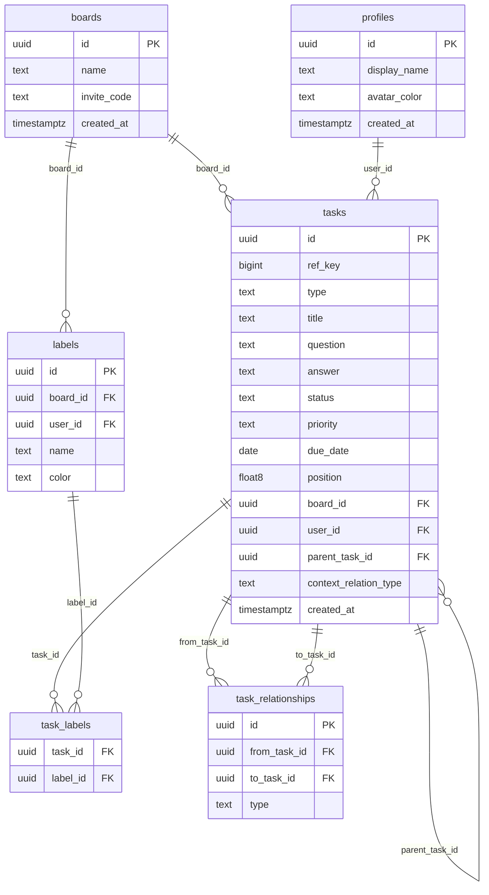

# Kanban Task Board

A polished, real-time collaborative Kanban board built for the Next Play Games SDE internship assessment.

## Stack

| | |
|---|---|
| **React 19 + TypeScript** | UI and type safety |
| **Vite 8** | Dev server and build tooling |
| **CSS Modules** | Component-scoped plain CSS, no utility framework |
| **@dnd-kit** | Accessible drag-and-drop |
| **Recharts** | Charts for the Review view |
| **Supabase** | Postgres, anonymous auth, Realtime, RLS |
| **Vercel** | Hosting and CI/CD from GitHub |

---

## What's built

### Multi-board workspace
The app starts at `/` — a list of all boards. Creating a board generates a unique slug and navigates to it. All boards share the same guest auth pool; anyone with the URL can join.

### Kanban board (`/board/:slug`)
Six columns represent the full task lifecycle. Tasks drag between columns to update status; order within a column is preserved and persisted. Changes sync in real-time to all open sessions via Supabase Realtime — a collaborator's move appears instantly without a reload.

```
 Backlog    Ready    In Progress   In Review   Completed  |  Context
┌────────┐ ┌───────┐ ┌───────────┐ ┌──────────┐ ┌──────────┐ ┌─────────┐
│ [task] │ │[task] │ │  [task]   │ │  [task]  │ │  [task]  │ │ [?] Q   │
│ [task] │ │[task] │ │  [task]   │ │          │ │  [task]  │ │ [!] note│
└────────┘ └───────┘ └───────────┘ └──────────┘ └──────────┘ └─────────┘
   ◀──────────────── drag-and-drop ───────────────▶    context pinned ──▶
```

### Task detail drawer
Clicking any card opens a slide-in drawer. All fields are editable inline and save on change — no submit button. Fields: title, status, priority, due date, labels.

### Context cards
Context cards are peer tasks that live in the Context column, linked to a parent task. Each has a **relation type** (Question / Assumption / Decision / Risk / Note), a **question** field, and an **answer** field filled in later. The relation type can be changed but the link to the parent is permanent.

Context can be added two ways:
- **New Task modal** — attach one or more context items at creation time
- **Task drawer** — "+ Add" in the Context section of any open task

Context cards show `→ KAN-N` on the board to identify their parent task.

### Labels
A dedicated Labels page (`/board/:slug/settings`) manages the board's label palette — 9 preset labels seeded on first visit, plus custom labels. Each label has a 12-swatch color picker. Labels are assignable to tasks from the New Task modal and the task drawer.

### Guest auth
On first load, a guest session is created silently via Supabase anonymous auth. No sign-up, no email. Each guest gets a random display name (`guest_CrazyAntelope`) and an avatar color. Identity persists across page refreshes via `localStorage`. The Profile page lets guests set a custom nickname.

### Real-time sync
All task mutations (create, update, reorder, status change) are persisted immediately. A Supabase Realtime channel scoped to the board's `board_id` pushes `postgres_changes` events to all connected clients. The subscription is paused during an active drag so a concurrent update doesn't interrupt mid-move.

---

## Roadmap

The items below are the remaining scope before the final submission.

| # | Item | Notes |
|---|---|---|
| 1 | ~~Rename Settings → Labels~~ | Done |
| 2 | ~Context cards — finish~ | Show context inline on task cards; answer editing polish |
| 3 | ~Assignment~ | User can claim a task; avatar shown on card; filter by assignee |
| 3b| Sign-In | When a user is signed in they should only see their tasks |
| 4 | ~Task relationships~ | `blocked_by`, `waiting_on`, `subtask`, `details` between tasks |
| 5 | Completion trickle-down | Completing a task propagates state to dependent/blocked tasks |
| 6 | Review panel | Wire real data into Recharts — status donut, completion over time, label breakdown |
| 7 | Audit against docs | Cross-check recommendations, README, and assessment brief for gaps |
| 8 | Test, clean DB, deploy | Final polish, seed data cleared, Vercel production deploy |

---

## Database schema



---

## Local development

```bash
npm install
npm run dev
```

Requires a `.env` file:

```
VITE_SUPABASE_URL=...
VITE_SUPABASE_ANON_KEY=...
```
