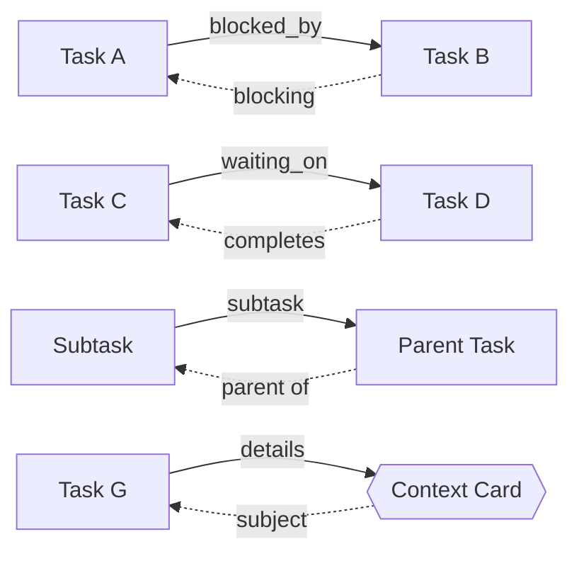
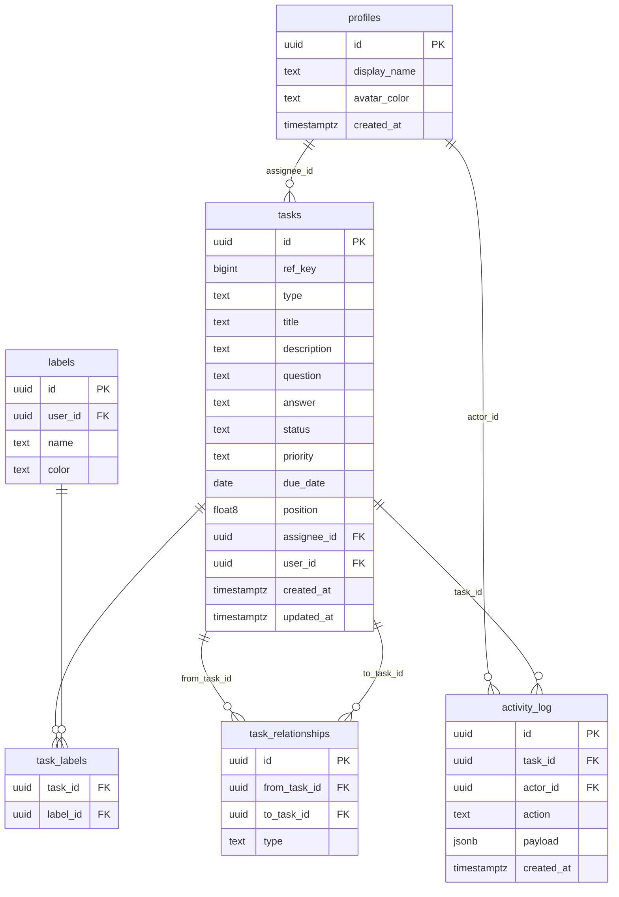

# Kanban Task Board

A polished, fully-featured Kanban board built for the Next Play Games SDE internship assessment.

## Stack

- **React + TypeScript** — UI and type safety
- **Vite** — dev server and build tooling
- **CSS Modules** — component-scoped plain CSS, no utility framework
- **@dnd-kit/core** — accessible drag-and-drop
- **Recharts** — composable charts for the Review view
- **Supabase** — Postgres database, anonymous auth, Row Level Security
- **Vercel** — hosting and CI/CD from GitHub

---

## App Structure

Three views connected by a persistent sidebar. The board is shared — all guests see all tasks and the full analytics picture. Guest sessions are created silently on first load; no sign-up required.

```
┌──────────────────────────────────────────────────────────────────┐
│  Sidebar                                                         │
│  ┌──────┐  ┌────────────────────────────────────────────────┐   │
│  │      │  │                                                │   │
│  │  🗂  │  │  BOARD VIEW                                    │   │
│  │Board │  │  Six columns · drag-and-drop · filter bar      │   │
│  │      │  │                          ┌──────────────────┐  │   │
│  │  👤  │  │  [Backlog][Ready][In Pr… │  Task Detail     │  │   │
│  │Profil│  │                          │  Drawer          │  │   │
│  │      │  │                          │  · relationships │  │   │
│  │  📊  │  │                          │  · activity log  │  │   │
│  │Review│  │                          │  · context links │  │   │
│  │      │  │                          └──────────────────┘  │   │
│  └──────┘  └────────────────────────────────────────────────┘   │
└──────────────────────────────────────────────────────────────────┘
```

### Board
The default view. Six columns represent the full task lifecycle. Tasks drag between columns to update status. Clicking a card opens a detail drawer on the right — this is where relationships, the activity log, and linked context cards live. A filter bar across the top narrows by search, priority, assignee, or label.

### Profile
No login screen. On first load a guest session is created silently via Supabase anonymous auth. The profile page lets the user set a nickname and pick an avatar color. Below that, a personal activity feed shows their recent actions across the shared board — tasks they moved, edited, assigned, or answered.

### Review
A lightweight analytics dashboard showing the health of the whole board. Four charts, all guests have full visibility.

| Chart | Type | Shows |
|---|---|---|
| Status snapshot | Donut | Current task count by column |
| Completion over time | Area | Tasks moved to Completed per day |
| Work by assignee | Horizontal bar | Open vs. completed per profile |
| Label breakdown | Bar | Task count per label |

---

## Board Layout

Tasks flow left to right through the first five columns via drag-and-drop. The **Context** column is permanent — context cards (questions, notes, blockers) live there and never move, but can be linked to any task.

```
 Backlog    Ready    In Progress   In Review   Completed  |  Context
┌────────┐ ┌───────┐ ┌───────────┐ ┌──────────┐ ┌───────────┐ ┌─────────┐
│        │ │       │ │           │ │          │ │           │ │ [?] Q&A │
│ [task] │ │[task] │ │  [task]   │ │  [task]  │ │  [task]   │ │ [!] note│
│ [task] │ │[task] │ │  [task]   │ │          │ │  [task]   │ │ [x] blkr│
│        │ │       │ │           │ │          │ │           │ │         │
└────────┘ └───────┘ └───────────┘ └──────────┘ └───────────┘ └─────────┘
   ◀─────────────── drag-and-drop ──────────────▶    context cards pinned ──▶
```

## Task Relationships

Tasks and context cards can be linked. Each relationship type is directional — the inverse is derived automatically in the UI.



A **context card** lives in the Context column and holds a `question` + `answer` instead of a title and description. It shares labels, priority, and assignee with regular tasks. Tasks link to context cards via the `details` relationship to surface relevant questions or blockers without being gated by them.

---

## Features

**Core**
- Six-column shared Kanban board with drag-and-drop reordering
- Guest sessions via Supabase anonymous auth — no sign-up, all guests see the full board
- RLS enforced: all users can read; only the creator can edit or delete their own items

**Tasks**
- Create tasks with title, description, priority (`low` / `normal` / `high`), and due date
- Human-readable task IDs (`KAN-1`, `KAN-2`, …)
- Due date indicators — overdue and due-soon highlighted on the card
- Assign tasks to any team profile

**Context Cards**
- Permanent cards in the Context column with `question` and `answer` fields
- Same labels, priority, and assignee support as tasks
- Linked to tasks via relationships (`details` ↔ `subject`, `blocked_by` ↔ `blocking`)

**Task Relationships**
- `blocked_by` / `blocking` — task is waiting on another to be resolved
- `waiting_on` / `completes` — task depends on another completing first
- `subtask` / `parent` — hierarchical; parent implicitly waits on all children
- `details` / `subject` — informational link to a context card, no blocking implied

**Team & Organization**
- Guest profiles with nickname and avatar color (set on the Profile page)
- Labels / tags with custom color, assignable to tasks and context cards, filterable
- Activity log per task — timeline of status changes, edits, and assignments

**Review**
- Donut, area, horizontal bar, and bar charts
- All charts reflect the full shared board, visible to every guest

**Search & Filter**
- Search by title
- Filter by priority, assignee, or label

---

## Database Schema

Six tables. The board is shared — `tasks` are readable by all authenticated users (including anonymous guests). Write operations are scoped to the creator via RLS. See `schema.sql` for the full schema and policies.



---

## Local Development

```bash
npm install
npm run dev
```

Requires a `.env` file with:

```
VITE_SUPABASE_URL=...
VITE_SUPABASE_ANON_KEY=...
```
