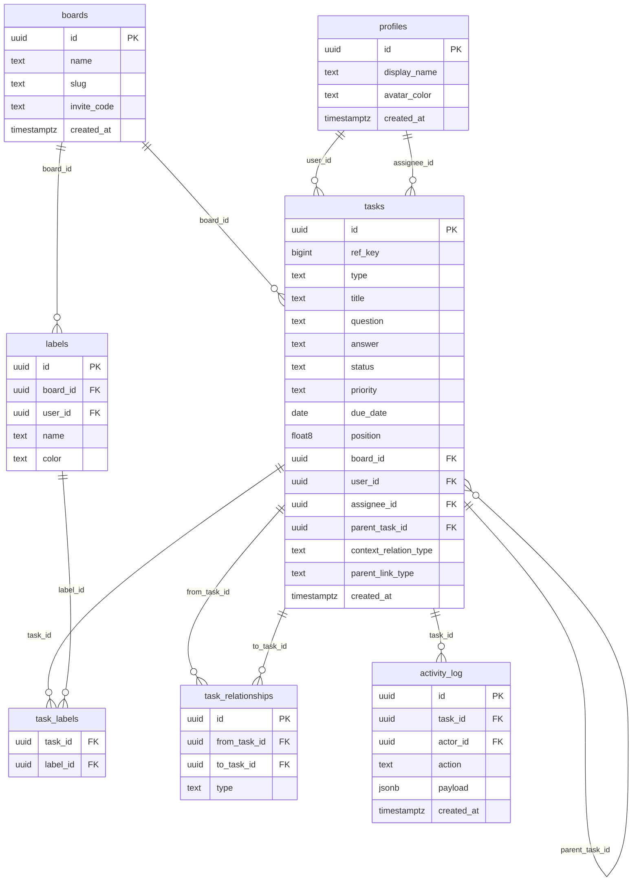

# Planning & Architecture

## Overview

A polished, real-time collaborative Kanban board built for the Next Play Games SDE internship assessment.

---

## Board layout

```
 Backlog    Ready    In Progress   In Review   Completed  |  Context
┌────────┐ ┌───────┐ ┌───────────┐ ┌──────────┐ ┌──────────┐ ┌─────────┐
│ [task] │ │[task] │ │  [task]   │ │  [task]  │ │  [task]  │ │ [det]   │
│ [task] │ │[task] │ │  [task]   │ │          │ │  [task]  │ │ [?] Q   │
└────────┘ └───────┘ └───────────┘ └──────────┘ └──────────┘ │ [·] Cmt │
   ◀──────────────── drag-and-drop ───────────────▶            └─────────┘
```

---

## Database schema



---

## Context card types

Each task has exactly one **Details** card (required, auto-created, cannot be removed). Additional context can be attached:

| Type | Purpose |
|---|---|
| **Details** | Description field + full activity log for the parent task |
| **Question** | An open question linked to the task; has a link type (Blocking / Waiting On / More Info) and an answer field |
| **Comment** | A freeform note attached to the task |

---

## Activity log actions

| Action | Payload |
|---|---|
| `task_created` | — |
| `title_edited` | `{ from, to }` |
| `status_changed` | `{ from, to }` |
| `priority_changed` | `{ from, to }` |
| `assigned` | `{ name }` |
| `unassigned` | — |
| `due_date_set` | `{ to }` |
| `due_date_cleared` | — |
| `comment_added` | — |
| `question_added` | — |

---

## Completion cascade

Completing a task triggers `executeCompletion()` in `src/lib/completion.ts`, which:

1. Finds all `blocks` relationships from the completed task
2. Cascades completion to any downstream tasks that have no other incomplete blockers
3. Deletes satisfied `blocks` relationships
4. Logs `status_changed` activity for each cascaded task

---

## Roadmap

| # | Item | Status |
|---|---|---|
| 1 | Rename Settings → Labels | ✅ Done |
| 2 | Context cards | ✅ Done — Details / Question / Comment types |
| 3 | Assignment + focus mode | ✅ Done — assignee on card; focus toggle in board header |
| 4 | Task relationships | ✅ Done — `blocks` / `blocked_by` / `waiting_on` / `parent_of` |
| 5 | Completion cascade | ✅ Done — propagates to blocked tasks |
| 6 | Review panel | ✅ Done — activity timeline + work-by-assignee chart |
| 7 | Audit against docs | ✅ Done |
| 8 | Test, clean DB, deploy | 🔲 Remaining |

### Stretch goals (post-submission)

- Review: status snapshot donut chart
- Review: label breakdown chart
- Search bar on the board
- Subtask relationships (currently only `blocks`/`waiting_on`)
- Sign-in (named accounts vs anonymous guest)
